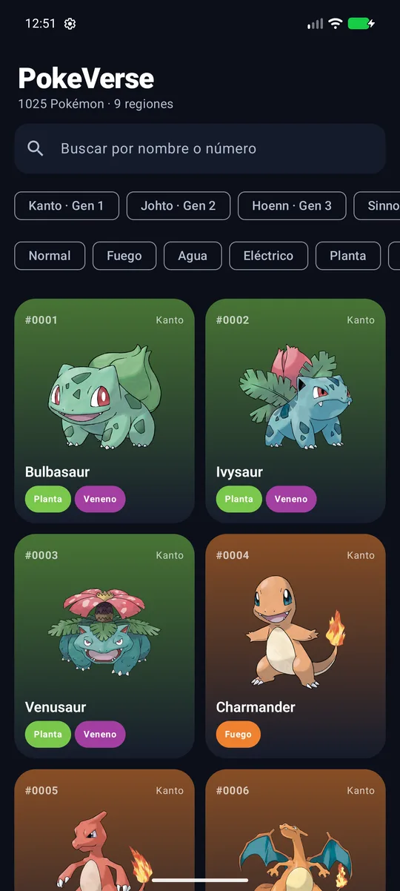
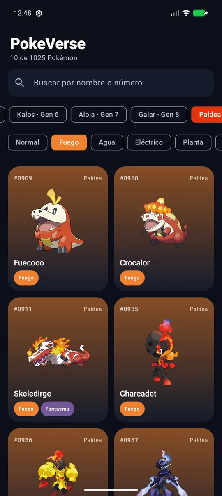
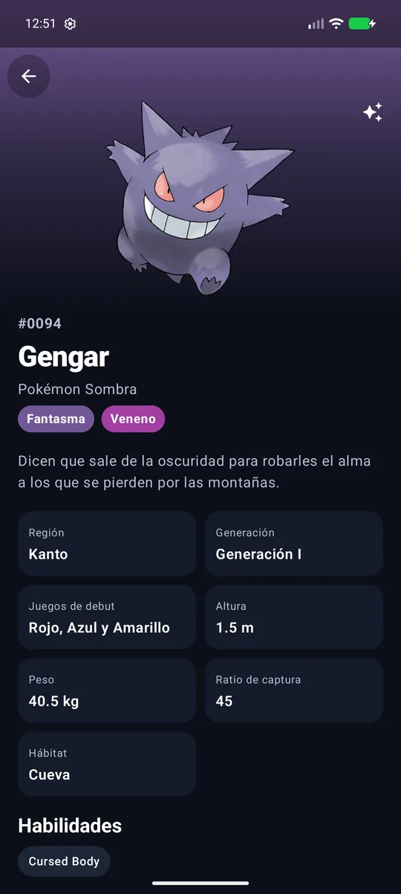
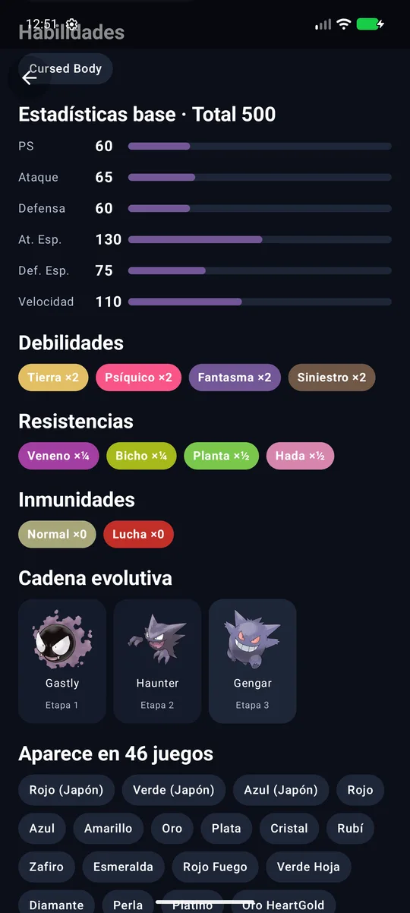

# PokeVerse ⚡

**Pokédex nativa para Android** con los **1025 Pokémon** de las nueve generaciones (Kanto → Paldea).
Cada Pokémon muestra su **región y generación**, los **juegos en los que aparece**, sus **tipos**,
**debilidades, resistencias e inmunidades**, estadísticas, habilidades y cadena evolutiva. Los datos
vienen de [PokeAPI](https://pokeapi.co) y se guardan en caché para usarse **sin conexión**.


| Lista | Filtros | Detalle | Debilidades y evoluciones |
|:---:|:---:|:---:|:---:|
|  |  |  |  |

---

## Tabla de contenido

- [Funcionalidades](#funcionalidades)
- [Stack tecnológico](#stack-tecnológico)
- [Arquitectura](#arquitectura)
- [Decisiones técnicas](#decisiones-técnicas)
- [Estructura del proyecto](#estructura-del-proyecto)
- [Compilar y ejecutar](#compilar-y-ejecutar)
- [Pruebas](#pruebas)

## Funcionalidades

- 📚 **Pokédex Nacional completa** (#0001–#1025) en una cuadrícula adaptable con arte oficial.
- 🔎 **Búsqueda** por nombre (ignora tildes: `flabebe` encuentra *Flabébé*) o número (`#25`, `025`).
- 🗺️ **Filtro por región/generación** (Kanto, Johto, Hoenn, Sinnoh, Teselia, Kalos, Alola, Galar, Paldea)
  y **filtro por tipo**, combinables.
- 📄 **Ficha completa**: categoría, descripción de la Pokédex en español, región, generación, juegos de
  debut, altura, peso, ratio de captura, hábitat, habilidades (incluida la oculta) y estadísticas base
  animadas.
- ⚔️ **Debilidades, resistencias e inmunidades** con su multiplicador (×4, ×2, ×½, ×¼, ×0) calculados
  con la tabla de tipos actual para Pokémon de uno o dos tipos.
- 🎮 **Juegos en los que aparece**, en orden de lanzamiento y con su nombre en español — desde Rojo/Verde
  japoneses hasta Escarlata/Púrpura, sus DLC y Leyendas Pokémon: Z-A.
- 🧬 **Cadena evolutiva** navegable (incluye evoluciones ramificadas como Eevee).
- ✨ Alternar **arte variocolor (shiny)**.
- 📴 **Offline-first**: la lista y cada ficha visitada se guardan en Room.

## Stack tecnológico

| Área | Tecnología |
|------|------------|
| Lenguaje | Kotlin 2.0, Coroutines, Flow |
| UI | Jetpack Compose, Material 3, Navigation Compose, animaciones de Compose |
| Arquitectura | Clean Architecture (data / domain / presentation) + MVVM |
| Inyección de dependencias | Hilt (KSP) |
| Red | Retrofit 2 + OkHttp + kotlinx.serialization |
| Persistencia | Room |
| Imágenes | Coil |
| Pruebas | JUnit 4, kotlinx-coroutines-test |

## Arquitectura

```
presentation ──────────────────────────────────────────────────────────────
  PokemonListScreen ◄─ StateFlow ─ PokemonListViewModel
  PokemonDetailScreen ◄─ StateFlow ─ PokemonDetailViewModel
        │ usa casos de uso
domain (Kotlin puro) ──────────────────────────────────────────────────────
  SearchPokemonUseCase · RefreshPokemonUseCase · GetPokemonDetailUseCase
  GetTypeMatchupsUseCase · TypeChart · Region · PokemonType
  PokemonRepository (interfaz)
        ▲ implementa
data ──────────────────────────────────────────────────────────────────────
  PokemonRepositoryImpl ─┬─► PokeApiService (Retrofit)
                         └─► PokemonDao (Room: lista + fichas en JSON)
  PokemonMappers (DTO → dominio, nombres y juegos en español)
```

- **Fuente única de verdad**: la UI observa Room; la red solo rellena la caché.
- La capa de dominio no depende de Android: reglas como la tabla de tipos o las regiones se prueban con
  JUnit puro.

## Decisiones técnicas

- **1025 Pokémon con 19 peticiones**: en vez de pedir el detalle de cada Pokémon, la lista se arma con
  `GET /pokemon-species?limit=5000` (nombres e IDs) más `GET /type/{tipo}` para los 18 tipos, que
  devuelven qué Pokémon tiene cada tipo. Las 19 llamadas se hacen en paralelo con `async`.
- **Ficha en 3 llamadas** (`/pokemon`, `/pokemon-species`, `/evolution-chain`), cacheada como JSON.
- **Debilidades calculadas localmente** con la tabla de tipos (generación VI+), sin llamadas extra.
- **Región** por la generación que indica la API, con respaldo por rango de número nacional.

## Estructura del proyecto

```
app/src/main/java/com/cordobot/pokeverse/
├── data/
│   ├── local/        PokemonDatabase.kt (entidades + DAO)
│   ├── mapper/       PokemonMappers.kt
│   ├── remote/       PokeApiService.kt, dto/
│   └── repository/   PokemonRepositoryImpl.kt
├── di/               AppModule.kt
├── domain/
│   ├── model/        Pokemon.kt, PokemonType.kt, Region.kt, TypeChart.kt
│   ├── repository/   PokemonRepository.kt
│   └── usecase/      PokemonUseCases.kt
└── presentation/
    ├── components/   TypeBadge.kt
    ├── detail/       PokemonDetailScreen.kt, PokemonDetailViewModel.kt
    ├── list/         PokemonListScreen.kt, PokemonListViewModel.kt
    ├── navigation/   PokeVerseNavHost.kt
    └── theme/        Theme.kt
```

## Compilar y ejecutar

Requisitos: Android Studio (Ladybug o superior), JDK 17, Android SDK 35. No necesita API key.

```bash
./gradlew :app:assembleDebug
adb install -r app/build/outputs/apk/debug/app-debug.apk
```

## Pruebas

```bash
./gradlew :app:testDebugUnitTest
```

- `TypeChartTest`: Charizard ×4 a Roca e inmune a Tierra, Garchomp ×4 a Hielo, Acero con 10 resistencias…
- `SearchAndRegionTest`: regiones por número y generación, búsqueda sin tildes y por número, filtros
  combinados, nombres y juegos en español.

---

Datos: [PokeAPI](https://pokeapi.co). Pokémon y sus nombres son marcas de Nintendo / Game Freak / The Pokémon Company;
este es un proyecto de portafolio sin fines comerciales.

Desarrollado por **Adrián Alvarez** ([@Cordobot](https://github.com/Cordobot)).

© 2026 Adrián Alvarez. Todos los derechos reservados.
